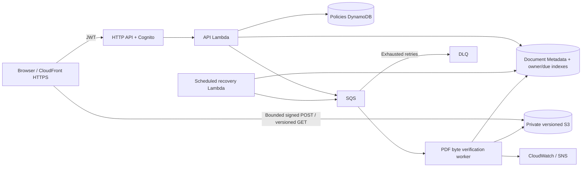

> D4 local-only review: [final readiness](docs/d4-final-readiness-review.md), [internship report summary](docs/d4-internship-project-summary.md). D3-A remains **BLOCKED_PENDING_OWNER_OPERATIONAL_CONFIRMATION**; [owner checklist](docs/d3a2-owner-operational-confirmation.md) is prepared, not answered. Public push/Pages and cleanup remain NO-GO. No fresh AWS health check or E2E is claimed.
>
> D2 update: public credential-candidate exposure confirmed in commit80c4eef (four auth scripts plus PROJECT_SUMMARY.md). Metadata maps one legacy policy-assistant Cognito identity, not TestA/TestB; validity/rotation/unauthorized access UNKNOWN. [D2 review](docs/d2-secret-exposure-review.md), [D3 proposal](docs/d3-credential-containment-approval.md) (D3-A conditional approval is blocked; other actions need separate approval). Public push remains NO-GO.

# AWS Policy Assistant — verified test demo

A working policy lookup and owner-isolated PDF document application for the First Cloud AI Journey internship. Includes a browser UI, API/worker/recovery backend, offline full-stack demo, AWS SAM infrastructure, automated tests, deployment/runbook documentation and a handover packager.

**Scope:** keyword search and PDF byte verification. No Bedrock/RAG, OCR, semantic search, malware scanning or policy text extraction is claimed. Local acceptance is complete only when `scripts.verify` passes; dated AWS evidence is summarized below; future execution requires separate authorization.

## Current verified status — 2026-10-22

Test stack `policy-assistant-fcaj-test`, ap-southeast-1, account …0098 reached **UPDATE_COMPLETE** after the approved API-only presigner update. Frontend: https://d3ataim7dfsl7t.cloudfront.net/ . D1 uses dated evidence, not a fresh AWS health check.

| Evidence | Result |
|---|---|
| B4 AWS API/SDK |19 PASS; browser NOT_RUN at that stage |
| Original B5 browser |FAIL upload; retained as history |
| B5-R7 real Edge browser |10 PASS after fix: login/search/upload/process/download/hash/ownership/logout |
| C0 inventory |45 resources/4 Retain; GO bounded test demo, NO-GO production |

**Environment end date has not been set by the owner.** DLQ has approximately one diagnostic message/ALARM; alarm SNS topic has **0 subscriptions**. Budget20USD/month is account-wide, not a cap; email delivery is unverified. Cleanup and Git commit/push are not authorized.

Presigner `addressing_style="virtual"` fits regional S3 CSP without broadening IAM/CSP/CORS. Deployed API has the new ZIP; Worker/Recovery retain the old verified ZIP. Source SAM still shares CodeUri: a future generic package/deploy can update all three, unlike the reviewed API-only update.

See [D1 Git/handover review](docs/d1-handover-review.md), [R7 result](docs/aws-browser-b5r7-result.md), [C0 cleanup options](docs/cleanup-c0-inventory-and-acceptance.md) and [demo script](docs/demo-script.md). No production readiness or AI/RAG/OCR is claimed.

## Start the complete demo (no AWS account required)

On this Windows checkout:

```powershell
.venv/Scripts/python.exe -m scripts.demo_server
```

For a fresh Windows environment:

```powershell
pwsh -File scripts/start-demo.ps1
```

Open the printed loopback URL. Sign in as **alice@demo.local** without a password. Look up `POL-001`, search `refund`, upload a synthetic PDF (up to 10 MiB), wait for the worker, download with SHA-256 verification and refresh **Tài liệu của bạn**. Sign out, sign in as **bob@demo.local**, and verify that Alice's ID returns 404.

The offline server runs the **real Lambda handlers** with moto-simulated S3/DynamoDB/SQS; authentication and the signed-URL adapter are explicitly local substitutes. It binds only 127.0.0.1. All demo data disappears on shutdown. It does not contact AWS or validate real Cognito tokens. Ctrl+C stops the demo.

## Setup on other environments

Python 3.12 and Node.js 22+ are recommended:

```bash
python3.12 -m venv .venv
# Activate the environment using your shell's activation script.
python -m pip install -r policy_assistant/requirements.txt -r tests/requirements.txt
npm ci
npx playwright install chromium
python -m scripts.demo_server
```

Windows browser tests use system Edge; other platforms use Playwright Chromium. AWS SAM CLI is needed for infrastructure checks. Dependency manifests include the test/simulation dependencies separately from Lambda runtime dependencies.

## Capabilities

- Native Cognito login, initial password-change/MFA challenges, in-memory refresh and logout. Manual token mode remains an advanced diagnostic option. The current pool defaults to MFA OFF; accounts are administrator-provisioned.
- Exact policy lookup and bounded keyword search with next-page navigation.
- Owned upload sessions, named document library, processing status, retry and verified downloads.
- Private S3 versioning: submissions and downloads use the same immutable version.
- Worker success is idempotent; stale delivery attempts cannot affect newer retries.
- Explicit failed states for invalid PDFs and exhausted transient processing. Scheduled indexed recovery covers metadata/queue-send gaps.
- Private S3 frontend hosting through CloudFront OAC/HTTPS with security headers and matching API/document CORS, defined in SAM.
- CloudWatch alarms/logs, SNS notification topic and optional confirmed email subscription.

## Architecture

The Mermaid below is an assistant reference, not a student-authored FCAJ diagram. Use [the self-drawing worksheet](docs/architecture-self-draw.md) to create and explain your own official-icon diagram.



Each document's owner comes from the API Gateway JWT authorizer `sub`. Unknown, unowned legacy and other users' records are not exposed. Metadata listing uses an owner index. Submit freezes the S3 version and a processing attempt ID; the worker verifies bytes/hash for that attempt. A bounded two-minute recovery task re-enqueues due pending work. Invalid PDFs become terminal failures; the owner can retry transient failures as a new attempt without changing bytes. See [operations](docs/operations.md).

## Verify everything offline

```powershell
.venv/Scripts/python.exe -m scripts.verify
```

This runs selected fatal Python lint checks, backend mypy, JS syntax, backend tests, skipped-by-default live tests, frontend tests, mocked-service browser tests, a full-stack browser scenario, SAM lint and SAM build. It removes live-test opt-in variables from its child environment and writes a sanitized result to `docs/evidence/offline-acceptance.json`. CI config runs the same functional layers and never deploys.

Individual commands:

```powershell
.venv/Scripts/python.exe -m pytest tests/unit -q
npm test
npm run test:browser
npm run test:local
$env:PATH = "$((Resolve-Path .venv/Scripts).Path);$env:PATH"
sam.cmd validate --lint
sam.cmd build
```

See [verification record](docs/final-verification.md) and [evidence index](docs/evidence-index.md). Local/mocked screenshots are not AWS proof; R7 screenshots accompany the real AWS browser evidence.

## API

| Route | Access | Purpose |
|---|---|---|
| `GET /health` | Public | Handler liveness |
| `GET /policies/{policy_id}` | JWT | Lookup |
| `GET /policies?keyword=...&limit=...&next_token=...` | JWT | Bounded search |
| `GET /documents?limit=...&next_token=...` | JWT + owner | Private paginated library |
| `POST /documents/upload-session` | JWT + sub | Named owned session |
| `POST /documents/submit` | JWT + owner | Freeze bytes, enqueue or retry |
| `GET /documents/{doc_id}/status` | JWT + owner | State, timestamps, failure code and hash |
| `GET /documents/{doc_id}/download` | JWT + owner | Processed version URL |

Details: [API contract](docs/api-contract.md).

## AWS deployment boundary

No deployment or publication is performed automatically. `samconfig.toml` defaults to the old `policy-assistant` stack: never run default deploy/sync as a test-demo step. **Previously committed passwords require rotation/revocation evidence before public push**; D1 does not change credentials or history. Follow [operations](docs/operations.md) only with separate authorization. Preserve existing data and never guess an owner for legacy records.

For a future separately authorized operation, export public outputs with `python -m scripts.export_frontend_config --stack policy-assistant-fcaj-test --output .aws-sam/test-review/public-config.json`; review them before any upload. Do not overwrite the blank portable frontend config for handover. Local `python -m http.server 8080 --directory frontend` needs the intended public configuration; the complete offline server supplies its own local configuration.

`tests/integration` requires both `AWS_SAM_STACK_NAME` and `POLICY_ASSISTANT_ID_TOKEN`; only run directly after choosing the intended account. `scripts/check_live.py --help` describes an explicit live policy/document verifier. Neither is part of an automatic AWS deployment.

## Handover and report

```powershell
.venv/Scripts/python.exe -m scripts.build_release
```

Creates `dist/handover/policy-assistant-source.zip`, `policy-assistant-frontend.zip` and a SHA-256 manifest. The builder selects directories/extensions and excludes Git history; it is not a security scanner or an exact per-file Git allowlist. It does not honor every Gitignore rule. Inspect its manifest/ZIP contents before sharing; D1 does not build or certify a release ZIP. Credential rotation is still required.

- [FCAJ gap analysis](docs/fcaj-gap-analysis.md)
- [Dated official AWS COST](docs/cost-estimate.md)
- [Student architecture worksheet](docs/architecture-self-draw.md)
- [Technical internship report](docs/internship-report.md)
- [FCAJ demo script](docs/demo-script.md)
- [Current handover](docs/final-handover.md)
- [Operations/deployment](docs/operations.md)

## Practical limits

A complete MVP is not a production certification. Search uses Scan (at most 1,000 evaluated items per request) and is not a stable snapshot under concurrent writes. Document/library and recovery indexes are eventually consistent. Recovery processes at most 20 due items per scheduled invocation; sustained overload/database outages require operator intervention. Signed POST constrains key, MIME and 5 bytes–10 MiB at S3; deployment enforcement remains a live acceptance check. PDF checks are byte/header verification only. S3 current expiry is 365 days plus noncurrent expiry 365 days after becoming noncurrent; versions can remain roughly 730 days. User self-registration/password reset, production custom domains, production load/cost targets are not delivered; live acceptance is limited to dated B4/R7 evidence.
