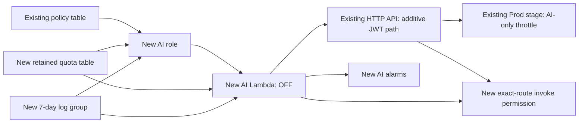

# AI infrastructure OFF-only draft — D43

Baseline source: `e28166a9f3a7e6d0a817f3efae3b18c750f4c0bf`.
This is a local preparation tool and fragment, not an AWS deployment or an enabled
AI product. No commit, push, model call or resource change is authorized by D43.

## What is prepared

- `infra/ai-off-fragment.json`: nine native CloudFormation resource definitions,
  including one Bedrock policy that cannot be active with current allowed values.
- `infra/ai-corpus-candidates.json`: POL-001–003 fingerprints from D42; explicitly
  pending, **not** a runtime authorization manifest.
- `infra/ai-sdk-versions.json`: explicit SDK distribution version lock used by the
  local artifact build; a different installed version makes the build stop.
- `scripts/prepare_ai_infrastructure.py`: offline composer and AI-only ZIP builder.
  It refuses SAM source templates/Globals, unpinned existing function code,
  unexpected resource edits, an existing AI route, mismatched corpus/baseline
  hashes and any output inside the repository. It never imports an AWS client.
- AI handler instrumentation emits low-cardinality CloudWatch EMF and sanitized
  failure-stage events. No question, policy text, subject, completion, token value
  or exception message is passed to telemetry. Numeric model token usage is safe
  telemetry, not an authentication token. Existing API/Worker/Recovery source and
  behavior are unchanged.

`template.yaml` and `samconfig.toml` are intentionally unchanged. The default SAM
stack is legacy `policy-assistant`: **never run default deploy for this draft**.

## Candidate generation: strictly local

Use a separately verified processed template of `policy-assistant-fcaj-test` as
input, not a template copied from an unknown account or branch. For example:

```text
python scripts/prepare_ai_infrastructure.py \
  --baseline <protected-test-processed-template.json> \
  --expected-baseline-sha256 <verified-canonical-json-sha256> \
  --stack-name policy-assistant-fcaj-test \
  --output <new-private-directory-outside-repository>
```

The baseline SHA is SHA-256 of `json.dumps(template, sort_keys=True).encode()`.
The tool does not itself prove account ownership/fresh AWS state; those checks
are mandatory before any future upload/change-set operation. Output must be a
new/empty protected directory; no automatic overwrite/delete/cleanup is provided.

Outputs: `candidate.json`, `ai-only.zip`, `build-evidence.json`. The ZIP contains
only ai.py and the enumerated installed SDK distributions/metadata, with versions
and checksum recorded. It excludes app.py, frontend, tests, credentials, source
history and auth artifacts. Reproduce with the same verified SDK environment;
do not treat arbitrary local dependencies as approved for deployment. Review the
dependency manifest/checksum and pin/rebuild the approved environment before use.
Existing mixed-version Lambda artifacts are kept exactly from the baseline.
The lock is reproducibility evidence, not a claim that dependencies underwent a
complete vulnerability audit. It must be part of deployment artifact approval.

Before any future change set, preserve **all existing stack parameter values**
explicitly (UsePreviousValue or a verified equivalent), especially TableNamePrefix
and frontend origin. A processed template contains parameter definitions/defaults,
not proof of current parameter values. Never substitute legacy defaults for the
test stack. The offline resource comparison does not prove parameter-driven AWS
effects; review the actual change set under the exact approved account/stack.

The candidate embeds the new route in the existing processed OpenAPI Body using
its existing JWT security scheme. It does not create a duplicate authorizer or
change the existing policy/document/health routes. Only two existing resources
change: HTTP API Body (new path + Idempotency-Key CORS) and Prod stage RouteSettings
(AI route 1 request/s, burst2). Preserve all old API defaults/origins/security.

Nine additions: AIQuotaTable, AILogGroup, AIRole, AIFunction, AIInvokePermission,
AIBedrockPolicy (false condition), AIFallbackAlarm, AIErrorAlarm, AIThrottleAlarm.
CloudFormation will only instantiate eight while the permission condition is
false. These are **local structural counts, not an actual AWS change set**;
runtime/dependency/replacement effects still require future review.

Native AWS::Lambda::Function is deliberate: SAM Globals on the shared source
would otherwise merge document bucket/queue configuration into a SAM AI function.
The native AI function has only policy/quota/AI configuration, no S3/SQS metadata.



No dependency from AI Lambda to API is needed, avoiding an API/function cycle.

## OFF defense and pending approvals

The CloudFormation parameters are locked to these sole AllowedValues:

| Parameter | Only allowed value |
|---|---|
| AIFeatureEnabled | `false` |
| AIApprovedSubjects | empty string |
| AIApprovedPolicyManifest | `{}` |
| AIBedrockPermissionApproval | `PENDING` |

The model policy condition compares the last value to `APPROVED`, which is not
selectable in this draft. Thus no active Bedrock Allow is created. Feature OFF
returns before any SDK client, policy retrieval, quota write, CountTokens or
Converse. JWT is still mandatory; OFF callers get a disabled fallback response,
not AI access. Unlocking parameters/permissions later is a new patch and approval,
not a deployment parameter trick. Do not edit the candidate to bypass the gates.

Role permissions outside the dormant model policy: exact log group stream writes;
GetItem only on the existing test PoliciesTable with LeadingKeys restricted to
POL-001–003; PutItem/UpdateItem only on the new ledger and transactional operation.
No managed wildcard policies, S3, document table, SQS, Cognito admin or Scan.
The Lambda permission requires exact API/stage/POST/ai/ask and SourceAccount.

Dormant Bedrock proposal: InvokeModel on the exact APAC profile and six exact
Nova Lite destination model ARNs; foundation-model statement constrained by
InferenceProfileArn. CountTokens is separate and foundation-model-only in
Singapore, without the unsupported profile condition. Refresh destination lists
and effective IAM/SCP checks before activating any permission. No broadening to
`bedrock:*` or all models to work around compatibility errors.

## BLOCKED_CONCURRENCY for enablement

D42 observed account concurrency10, unreserved10. No ReservedConcurrentExecutions
property is set in this OFF-only candidate; it does **not** claim capacity2 or
isolation. Positive reserved2 was not feasible under the documented requirement
to leave100unreserved. API/Worker/Recovery/legacy share the account pool, so AI
could starve existing work if enabled without a separately accepted capacity plan.

Alternatives requiring explicit decisions:

1. Owner-approved quota feasibility/increase, then a separately reviewed
   reserved-concurrency configuration; no quota request is made here.
2. Keep quota10 and review application semaphore/admission changes plus account
   contention tests. A semaphore limits model work, not Lambda slots consumed by
   requests; this is not equivalent capacity protection and is **not implemented**.

OFF returns quickly without model/data calls but still consumes a Lambda invocation
and may contend during abusive traffic; route throttle is best effort, not a hard
account isolation boundary. No safe enabled alternative is established in D43.
**AI enablement remains BLOCKED_CONCURRENCY.**

## CountTokens and corpus gates

Current runtime still passes `apac.amazon.nova-lite-v1:0` to both CountTokens and
Converse. Exact profile CountTokens support remains UNKNOWN; trial NOT_RUN. The
IAM proposal deliberately does not pretend an inference-profile CountTokens ARN
is a documented resource type. Count failure still fails closed before Converse,
does not refund the reservation and does not drop the input token limit.

After separate approval, bounded compatibility diagnostics can determine whether
the profile works or a separate exact foundation-model counter is required. Any
runtime change to use a foundation-model identifier requires a new code review,
same exact prompt/model, tests and owner approval. No chars/token shortcut.

The build rehashes POL-001–003 from seed against D42 canonical candidates before
packaging. It does not fetch live policy text or approve external disclosure.
An AWS refresh before deployment must prove actual catalog hashes still match.
Owner approval of corpus and APAC routing is PENDING. Do not insert private policies
into the existing shared catalog. No PDF or personal document access is added.
Subject values remain empty and are not guessed/read/filled by this preparation.
APAC may route to Tokyo/Seoul/Osaka/Mumbai/Singapore/Sydney per D42; refresh actual
profile before approval. Do not promise Singapore-only handling.

## Monitoring and cost

Text-format Lambda logs preserve EMF JSON. Three metric names in namespace
PolicyAssistant/AI, dimension FunctionName only: ModelAttempts, Fallbacks,
QuotaDenied. The last includes idempotency/transaction cancellations. Operational
Fallbacks excludes expected AI_DISABLED and INSUFFICIENT_EVIDENCE; those are logged
with zero operational count. Model/count/ledger/citation errors record a fixed
stage plus an operational fallback, never raw exception content. Model errors
returning HTTP200 are visible to the fallback alarm even when Lambda Errors=0.

Alarms: operational Fallbacks, Lambda Errors and Throttles >=1 over5minutes,
missing data notBreaching. AlarmActions reference the existing topic, but D42
observed **zero SNS subscriptions**. No test message/subscription is created and
no email delivery is asserted. Logs/metrics/alarms are not an automatic kill switch.

Before enabling: verify sanitized EMF events and extraction, each metric dimension,
failure/quota/duplicate behavior, IAM denying unexpected resources, alarm state
transitions and separately authorized notification reception. All synthetic
failure injection/live trials need their own limits and approval; none ran here.

D42 scenario remains illustrative:1000accepted calls at6000input/700output tokens,
256MiB/15billable seconds, tiny DB/log storage,3custommetrics+3alarms gives roughly
$2/month incremental, of which model tokens $0.7128. New alarms/storage can incur
cost even while OFF; emitting zeros can create billable custom metrics. Not a
forecast, not a hard cap, excludes existing account costs and rejected traffic.
Budget$20 is an alert only. No Bedrock usage or cost was measured in D43.

## Rollout and rollback boundaries

1. Review/commit local patch only after validation and separate owner approval.
2. Refresh test account/stack/templates/Code refs/corpus/profile/concurrency, inspect
   artifact manifest and candidate diff. Approve upload/create change set separately.
3. Review exact AWS changes/replacements before separately authorizing execute OFF.
4. Resolve all concurrency/count/corpus/subject/APAC/monitoring gates before a new
   patch unlocks enablement; bounded Bedrock/auth/quota trial approval remains separate.
5. Frontend AI remains a later scope after backend acceptance; no CloudFront change.

If a future deployment fails, investigate read-only and stop, no automatic repair.
Rollback proposal is an owner-approved restore of the prior API Body/stage settings
or an OFF configuration, leaving legacy and three old Lambda definitions intact.
Retain quota counters across rollback and do not delete data or reset spend limits.
Any live stop/rollback is an AWS write requiring approval; no action occurs here.

Official references reviewed in D42/D43:
- https://docs.aws.amazon.com/lambda/latest/api/API_PutFunctionConcurrency.html
- https://docs.aws.amazon.com/bedrock/latest/APIReference/API_runtime_CountTokens.html
- https://servicereference.us-east-1.amazonaws.com/v1/bedrock/bedrock.json
- https://docs.aws.amazon.com/serverless-application-model/latest/developerguide/sam-specification-template-anatomy-globals.html

**Local OFF-only commit review: subject to validation. Deployment: NO-GO. Live AI:
BLOCKED_CONCURRENCY / COUNTTOKENS_UNKNOWN / PENDING_OWNER_APPROVAL.**
