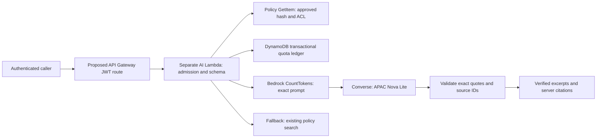

# AI Policy Assistant MVP — local implementation, D39

Baseline: `84e1d4d2a2dc8d7b4a62595ea0523697e5eafa2d`.
This implements a **separate Lambda handler** `ai.lambda_handler` under the existing
`policy_assistant` code directory. It does not change the existing API handler,
frontend, SAM template, IAM or deployed resources. `POST /ai/ask` is the contract
for a future explicitly authorized API Gateway route; that route **does not yet
exist in IaC or AWS**. No public AI UI is exposed. Feature defaults OFF.



## API contract

Request: `POST /ai/ask`, JSON content, Cognito JWT authorizer mandatory at the
gateway. Application identity comes only from `requestContext.authorizer.jwt.claims.sub`.
Do not accept arbitrary caller-provided claims; a future Lambda permission must
limit invocation to the approved API route. An idempotency header is required:

```http
Idempotency-Key: synthetic-request-0001
```

```json
{"question":"What is the refund period?","policy_ids":["POL-001"]}
```

Only those two body keys are accepted. No PDF, document ID, S3 key, owner override,
URL, model override, conversation history or attachment field. Questions can
still contain personal information typed by a user: input-size validation is not
a PII guarantee. Future UI must warn users not to submit personal data.

Answer:

```json
{
  "status":"answered",
  "answer":"Refunds within 30 days.",
  "answer_type":"verified_source_excerpts",
  "citations":[{
    "policy_id":"POL-001",
    "quote":"Refunds within 30 days.",
    "source":{"type":"policy","path":"/policies/POL-001","content_sha256":"server-generated-hash"}
  }]
}
```

The hash binds policy ID, title, content and owner via `ai.fingerprint`, using
canonical JSON, not just the content text. Source paths/hashes are built by the
server. Never trust model-generated URLs or render model output as HTML.

No valid evidence: HTTP 200, `status=insufficient_information`, `answer=null`,
empty citations, fallback `{type:keyword_search,path:/policies,policy_ids:[...]}`.
Model/config/token-count/dependency failure: same fallback with `status=unavailable`.
Existing keyword-search UI/API remain usable; fallback does not perform a table
scan or issue a second model call. New frontend wiring is a separate future step.

Errors: 400 invalid/oversized body or missing idempotency header; 401 no authorizer
subject; 403 subject outside the explicit AI allowlist; 404 missing/unapproved/
unauthorized source (same external error); 429 quota/duplicate transaction denial.
Responses are `Cache-Control: no-store`. No questions, policy text, subject,
SDK exception text or model completions are logged by this module.

## Configuration and authorization

Environment variables, all server managed:

| Variable | Requirement |
|---|---|
| `AI_ENABLED` | Absent/anything except exact `true`: OFF |
| `AI_MODEL_PROFILE` | Required, exact `apac.amazon.nova-lite-v1:0`; no arbitrary model |
| `AWS_REGION` | Singapore `ap-southeast-1` |
| `AI_ALLOWED_SUBS` | Explicit comma-separated approved subjects; empty denies all |
| `AI_POLICY_MANIFEST` | JSON map: policy ID -> visibility, sha256, private owner_sub if needed |
| `POLICIES_TABLE_NAME` | Approved policy catalog table only |
| `AI_QUOTA_TABLE` | New dedicated ledger table, partition key `pk` string |

The source policy IDs are caller selected (1–3), but permission comes from the
server manifest. Shared policies are explicitly approved; private entries require
exact subject equality **before GetItem** and again on retrieved metadata. Exact
hash comparison detects content/title/ownership drift before assembling context.
Default Deny; unknown policies are never scanned/discovered. Do not populate the
manifest from unreviewed live items or let users modify it. D34 seed files alone
do not prove current AWS contents match. Approve/hash the real non-sensitive
corpus before any inference. No S3/document-table access is used by this handler.

Important existing-contract boundary: the current policy catalog/search endpoints
are shared, not a private-policy storage service. Initial deployment must use
only the existing shared, non-sensitive catalog. Do **not** insert private policy
rows into that catalog and assume the new AI ACL secures the old endpoints.
Private manifest support is tested locally at the AI boundary only; deploying
private sources needs an independently secured source store/read path and review
of all source links. No new whole-application private-policy claim is made here.

## Guardrails implemented

- Body <=4 KiB; question 1–800 characters and <=2400 UTF-8 bytes; 1–3 unique
  policy IDs. Context JSON <=6000 UTF-8 bytes. Only approved policy text/title/ID
  are sent; row metadata/owner IDs are excluded from the model prompt.
- Exact same system/messages supplied to CountTokens and Converse. Input <=6000
  model tokens; output `maxTokens=700`, temperature0. Unsupported/unavailable
  CountTokens fails closed without Converse. No estimated chars/token shortcut.
- SDK total attempts1, connect timeout1s; policy/ledger/token read timeout2s;
  model read timeout6s. Deadline checks against an application12s budget and
  Lambda remaining time. These checks prevent late model admission but are not
  a preemptive wall-clock timer; SDK DNS/retries outside application control,
  platform cold starts and latency still require real runtime validation.
- Atomic transaction reserves five UTC counters and one idempotency record:
  user5/minute, user20/day, global10/minute, global40/day, global1000/month.
  Multiple Lambda instances share limits. No local-memory rate limiter.
  Duplicates for the same subject/key/day cannot invoke twice. Reusing keys on a
  new UTC day is a new reservation; this is daily idempotency, not permanent
  deduplication or response caching. Frontend must generate a new key per intent
  and retain it on retries within a day. No automatic application retries.
- Reservation remains spent on count/model failure or timeout. No refund that
  could permit repeated billed attempts. TTL40days is retention only; counter
  key/calendar and conditional writes enforce limits. Do not reset counters,
  change table/profile or duplicate deployments to bypass the cost ceiling.
- Reservations bound accepted model attempts, not every rejected HTTP request or
  policy read. API Gateway throttling and reserved concurrency are still required
  to bound abuse/overhead; do not claim the model quota caps the AWS bill.
- Model chooses exact source quotes (max3, each <=400 chars); additional free
  answer fields, fabricated IDs/quotes/URLs, truncated/tool outputs are rejected.
  Plain excerpts are the answer, not unrestricted generated paraphrases.
- System instructions isolate untrusted policy/question text; no model tools or
  document access. Valid quotes do not prove relevance, nor fully solve prompt
  injection. Human VI/EN quality/injection evaluation remains a deployment gate.

## IAM / infrastructure proposal — not applied

Reuse existing API Gateway/Cognito/policy table, with a **separate AI Lambda/role**
to avoid giving the existing broad API role model access. Lambda handler
`ai.lambda_handler`, 15s timeout, proposed reserved concurrency2; approved corpus
manifest/subject allowlist initially limited to existing test identities. Configure
route authorizer/issuer/audience to the exact test pool/client. Route-level gateway
throttle proposed rate1/s, burst2 (not a per-user quota). No new public signup.

New on-demand DynamoDB quota table (`pk` string, TTL `expires`); CloudFormation
retention/backup/cleanup decisions need owner review. No ledger table or template
was created in D39. Propose log retention7–14days and explicit least-privilege role:

- `bedrock:InvokeModel` for exact approved inference-profile ARN and required
  Nova Lite foundation-model ARNs in its source/destination regions; use profile
  condition scoping where appropriate. No wildcard model/service permissions,
  no streaming/agents/KB permissions.
- `bedrock:CountTokens` resources as supported by service authorization reference;
  confirm exact model/profile/region compatibility before enabling inference.
- `dynamodb:GetItem` on policy table. Underlying `PutItem`/`UpdateItem` actions on
  ledger needed by transactions; no imaginary `dynamodb:TransactWriteItems` IAM
  action. No Scan, S3, document metadata, SQS or Cognito admin permissions.
- Exact log-group stream/write permissions only. No debug SDK logging or raw
  model invocation logs. Proposed metrics (not implemented/published in D39):
  request count, quota denied, model/count failures, latency and token usage;
  no subject/question in metric dimensions. Alarm thresholds require approval.

No IAM/SAM/CDK modification is included. A future explicit IaC candidate must
cover route, Lambda, ledger, IAM, throttling/concurrency, metrics/log retention and
rollback; inspect the actual change set before deployment. The current shared
packaging may cause multiple function/dependency updates: do not reuse the
previous frontend-only deployment procedure for this backend feature.

## Model, pricing and unresolved live gates

D34 account metadata snapshot on23Oct2026 showed the APAC Nova Lite profile active,
but no inference or exact CountTokens compatibility was tested. D39 makes **zero
authenticated AWS calls**. Current official model documentation lists
`apac.amazon.nova-lite-v1:0` and geographic routing from Singapore; this does not
mean data stays in Singapore. Owner must approve APAC destination/data handling,
including applicable abuse-monitoring handling, and refresh IAM/SCP/quota/model
availability before any live deployment.

Public AWS Singapore price-list rechecked23Oct2026, publicationDate
2026-10-16T21:08:06Z: Nova Lite standard input $0.081/1M tokens, output $0.324/1M.
At6000input+700output, planning upper token charge is $0.0007128/attempt and
$0.7128/1000reserved attempts/month (or $0.14256/200demo attempts). This arithmetic
is conditional on exact counting, output enforcement, unchanged prices/profile
and one shared durable ledger. It is not measured usage, forecast or total cost.
CountTokens is documented as free, but actual support is still a live gate.
Lambda, gateway, DynamoDB transactions/storage, logs, networking, taxes/support
and existing stack costs are additional. Account Budget$20 is an alert, not a cap.

Official sources:
- https://docs.aws.amazon.com/bedrock/latest/userguide/model-card-amazon-nova-lite.html
- https://docs.aws.amazon.com/bedrock/latest/userguide/count-tokens.html
- https://docs.aws.amazon.com/bedrock/latest/userguide/inference-profiles-support.html
- https://pricing.us-east-1.amazonaws.com/offers/v1.0/aws/AmazonBedrock/current/ap-southeast-1/index.json
- https://docs.aws.amazon.com/amazondynamodb/latest/developerguide/transaction-apis-iam.html

## Local validation and staged rollout

All Bedrock calls in tests are mocked; DynamoDB integration uses moto, not AWS.
Tests cover exact prompt token counting, citation integrity, missing/hash-drifted
sources, private A/B isolation, attachments/PDF rejection, prompt instructions as
untrusted data, malformed/fabricated output, timeout/error/no-retry, input/context
limits, default-off behavior and transactional user/global/day/month/idempotency
limits. Moto tests do not prove live contention, IAM or model quality/latency.
Full regression logs are recorded outside the repository in D39 evidence.

Next approvals: local commit review first; then frontend/UI and IaC integration
review as needed; then test-stack deployment and a separately bounded synthetic
live model trial. No automatic transition. Rollback proposal: disable AI feature
or route through an approved configuration/deployment; existing keyword search
continues. Preserve policies/documents and retain ledger reservations. No current
resources need rollback because no AWS changes have been made.
